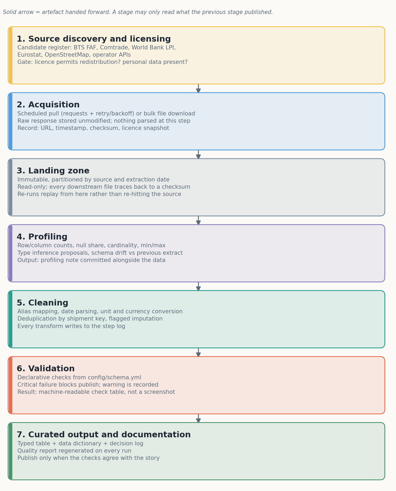
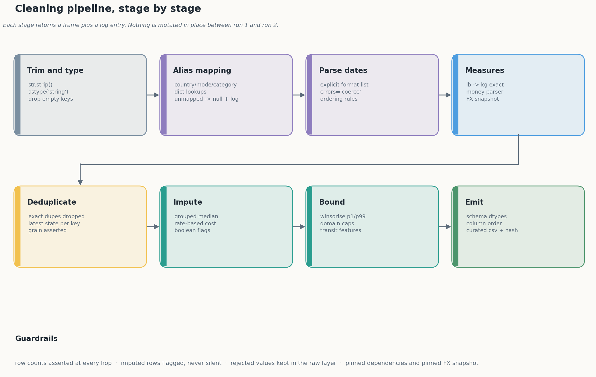
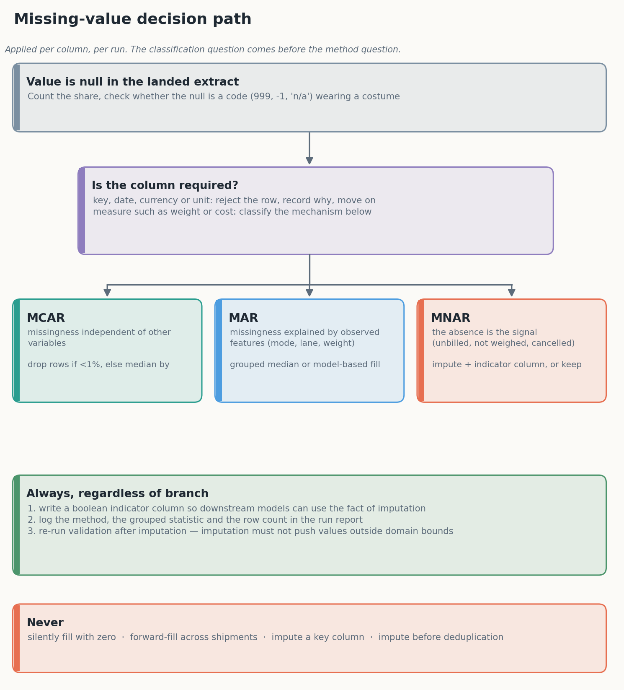

# Executive summary

This report sets out a strategy for identifying, collecting and cleaning
publicly available logistics data with Python. It is written as an operating
plan rather than a literature review: every stage names the tool that does the
work, the failure it is designed to catch, and the artefact it leaves behind
for a reviewer.

The argument runs in four movements. First, logistics data is not one dataset
but a family of them — freight flow estimates, customs records, vessel
positions, port statistics and carrier transactions — and each family fails in
a different way. Second, the useful public sources are identifiable and can be
reached through documented bulk downloads and APIs, but their licences differ
sharply, and a plan that ignores licensing produces a pipeline nobody can
publish. Third, cleaning is not a single pass but a sequence of bounded
transforms, each of which logs what it changed; the discipline of logging is
what separates a reusable pipeline from a one-off notebook. Fourth, missing and
inconsistent data are classification problems before they are imputation
problems, and the correct answer is frequently "flag it and move on" rather
than "fill it with the mean".

The strategy is demonstrated rather than asserted. A reference implementation
accompanies this document: a seeded extract deliberately containing the defects
seen in real freight feeds, a cleaning module of eight stages, thirteen
validation checks of which nine are fatal, nineteen unit tests, and a
regenerated data-quality report. On that extract the pipeline removes 180 rows
of duplication, rejects 86 implausible weights, converts four currencies to a
pinned USD snapshot, imputes 9.1 per cent of weights and 5.2 per cent of costs
with explicit flags, and publishes 4,200 typed rows with a checksum traceable
to the source file.

The deliverable is therefore three things at once: a plan, a set of diagrams
describing the workflow, and a working codebase that runs the plan and prints
the evidence.

# 1. Scope, objectives and success criteria

## 1.1 The problem this report addresses

Logistics analytics fails in a characteristic way. The models are rarely the
weak point; the data underneath them is. A shipment record may carry a weight
in pounds in one system and kilograms in another, a country written four
different ways, a delivery timestamp that precedes its despatch timestamp, and a
freight cost stored as the string `€1,240.50`. Any of these is survivable in
isolation. Together they make the difference between a dashboard that a planner
trusts and one that is quietly ignored.

The task set for week 1 is to design a strategy for gathering and preprocessing
publicly available logistics data, and to document it precisely enough that
another analyst could execute it. The deliverable is a Word document; the
supporting repository is where the strategy is proved to be executable.

## 1.2 Objectives

Five objectives structure the work:

1. **Identify** the families of public logistics data, their publishers, their
   grain and their access routes.
2. **Specify** a collection architecture that is repeatable: scheduled pulls,
   immutable landing, recorded provenance.
3. **Define** a preprocessing pipeline in Python, naming libraries and
   functions rather than gesturing at "using pandas".
4. **Set** rules for missing and inconsistent values that are defensible under
   review, including when *not* to impute.
5. **Document** the whole thing so that the cleaning is reproducible and the
   decisions are auditable.

## 1.3 Success criteria

A blueprint is only useful if it can fail. The following criteria make failure
visible:

| criterion | test |
|---|---|
| Reproducibility | a clean checkout plus a fixed seed reproduces the published table and its checksum |
| Traceability | every published row can be traced to a source extract, a run timestamp and a code version |
| Transparency | every transform that changes a value appears in a machine-readable log with a row count |
| Safety | no critical validation failure reaches the curated layer; the run exits non-zero instead |
| Portability | the same pipeline accepts a real FAF extract without structural rewrite |

These are deliberately stricter than "the document is well formatted". A
strategy that cannot be run is a hypothesis, and the evaluation criteria for
this task reward depth of technical detail, so the criteria above are the ones
the remainder of the report is measured against.

## 1.4 What is out of scope

Two capabilities are excluded on purpose. Geospatial enrichment — joining port
polygons, computing great-circle distances, snapping coordinates to road
networks — requires a reference dataset and a spatial index, and half-building
it would misrepresent the effort involved. Time-zone-correct timestamps require
origin and destination zone rules; the synthetic extract uses naive dates and
the decision log records the deferral. Neither is required by the tasks that
follow, so both are recorded as deferred in section 14 rather than faked here.

# 2. What logistics data actually looks like

## 2.1 The five families

Public logistics data falls into five families, and the family determines the
defects you will spend your time on.

**Freight flow estimates.** The US Freight Analysis Framework is the canonical
example: tonnage and value between origin–destination pairs, by commodity and
mode, estimated rather than observed [1]. Because it is modelled, its
"missingness" is structural — regions below a reporting threshold are pooled —
and its uncertainty is documented in a user guide rather than in the rows.

**Customs and trade records.** UN Comtrade and national trade statistics give
value and quantity by commodity and partner country [2]. These are
administrative: commodity codes follow the Harmonized System and change
revision, so a time series stitched across revisions will show a fake jump
unless concordance tables are applied.

**Movement and telemetry.** AIS vessel positions, ADS-B flight states and port
call records describe where things physically are [3]. They are high-volume,
irregularly sampled, and identified by opaque keys (MMSI, ICAO address) that
must be joined to reference tables before they mean anything.

**Operational transactions.** Carrier invoices, waybills and warehouse
movements are the data most analysts actually want and the data least likely to
be public. Commercial extracts are licensed, expensive, and frequently
anonymised to the point where lane-level analysis is impossible.

**Reference and context data.** Country codes, UN/LOCODE port codes, currency
tables, road networks and port boundaries. These are the join keys that make
the other four families usable, and they are the ones most often neglected
until a merge silently drops 12 per cent of rows.

## 2.2 The defects that recur

Across all five families, the same defects recur, and the strategy is organised
around them:

- **Unit drift** — kilograms and pounds, tonnes and short tons, cubic metres
  and cubic feet, all in the same column.
- **Vocabulary drift** — `Air`, `AIR`, `air freight` and `AWB` describing one
  mode; `U.S.A.`, `USA`, `US` and `United States` describing one country.
- **Temporal ambiguity** — `04/03/2025` is two different days depending on who
  typed it; timestamps without offsets across multiple zones.
- **Coded nulls** — `999999`, `-1`, `n/a` and the empty string all meaning
  "unknown", none of them recognisable as null to a naive reader.
- **Grain violations** — several rows per shipment because the feed emits a row
  per status change; a "duplicate" is often the current state of the world.
- **Free-text locations** — `Rotterdam 3011`, `ROTTERDAM`, `Rotterdam,
  Netherlands` as three distinct values in a city column.

Recognising these as a fixed catalogue rather than a series of surprises is
what allows the preprocessing design to be systematic. Each defect maps to one
stage of the pipeline, and each stage maps to a test.

## 2.3 Why the grain matters more than the columns

The single most consequential decision in any logistics dataset is the grain:
what does one row represent? A shipment, a consignment, a waybill line, a
pallet, a status event? A dataset that claims to be shipment-level but is
actually event-level will produce plausible-looking but wrong aggregates, and
no amount of cleaning will fix it. The strategy therefore asserts the grain
explicitly in the schema contract (`grain: one row per shipment_id`), tests it
after deduplication, and records in the data dictionary what a duplicate meant
before it was collapsed.

# 3. Public data sources and selection criteria

## 3.1 The register

Rather than a list of links, the project keeps a register
(`docs/sources.md`) recording what each dataset contains, how it is reached,
and what prevents naive use. The shortlist below is the part of that register
that matters for a first implementation.

| dataset | grain | access | decisive consideration |
|---|---|---|---|
| BTS Freight Analysis Framework (FAF5.7.1 / FAF6) [1] | O–D flows by mode and commodity, 132 zones | bulk CSV/ZIP, tabulation tool | documented methodology, versioned releases, public domain |
| UN Comtrade [2] | country–commodity–partner values | REST API, free tier | rate limits; HS revision changes break naive time series |
| IMF PortWatch [3] | daily port calls and transit activity | hosted layers, downloadable files | model-based, not a census; attribution required |
| BTS Border Crossing/Entry [4] | monthly counts per port, mode, direction | bulk download | clean and small; good first ingestion exercise |
| Eurostat freight transport [5] | tonnes-km by mode and region | bulk + SDMX API | free reuse with attribution; no shipment keys |
| OpenStreetMap [6] | roads, ports, terminals, boundaries | planet file, Overpass, Geofabrik | ODbL share-alike constrains derived databases |
| ECB reference rates [7] | daily bilateral FX | API, CSV | required for any multi-currency cost field |

## 3.2 Five gates

Each candidate was assessed against five gates, in this order:

1. **Grain and key.** Is there a defensible primary key, stated by the
   publisher rather than inferred? FAF has an O–D–commodity–mode key and a
   documented zone system; a Kaggle upload with an unnamed index does not.
2. **Licence.** May a derived table be redistributed? This eliminates several
   attractive commercial freight datasets immediately.
3. **Stability.** Is there a version number or dated release, so a figure
   quoted in a report can be tied to a specific extract? FAF's versioned
   releases (5.7.1 for 2018–2024; FAF6 for the 2022 benchmark) satisfy this
   [1]. An undated dashboard does not.
4. **Documentation.** Does a codebook exist for the categorical fields? Without
   one, "mode = 4" is uninterpretable and any cleaning is guesswork.
5. **Defect plausibility.** Does the data contain the mess this task is about?
   A perfectly tidy dataset teaches nothing about handling imperfection.

FAF passes all five and becomes the reference dataset for weeks 2–4. PortWatch
and Comtrade are the next additions. The popular Kaggle supply-chain datasets
fail gates 1 and 4: their grain is ambiguous and their provenance undocumented,
which is why pipeline development here runs on a synthetic extract whose
defects are known and seeded.

## 3.3 Why not simply scrape

Scraping port dashboards is technically trivial and strategically poor. It
produces an unversioned artefact, breaks without warning when a layout changes,
may breach the site's terms, and cannot be reproduced by a reviewer. Where a
publisher offers no machine-readable interface, the honest options are to
transcribe a single figure with a citation, or to approach the publisher.
Neither belongs in an automated pipeline, and treating them as if they did is
how data teams end up defending numbers they cannot regenerate.

# 4. Legal, ethical and licensing considerations

## 4.1 Open is not the same as unrestricted

Public availability and permission to reuse are different things. Three
distinctions matter in practice.

**Licence type.** Public domain (US federal works such as BTS datasets) allows
redistribution with citation. Permissive attribution licences (CC BY 4.0, used
by much World Bank material) allow reuse provided attribution is preserved.
Share-alike licences (ODbL for OpenStreetMap) impose a reciprocal obligation on
derived *databases*, which can affect a product built on a geocoded table.
Research-only terms (OpenSky) forbid commercial use outright. A pipeline that
mixes all four into one table inherits the strictest obligation in the mix, and
the register records that per source rather than per project.

**Personal and commercial data.** Shipment-level data frequently contains
consignee names, addresses, contact details and negotiated rates. Even where
analytics does not need them, their presence makes the dataset personal data
under GDPR and equivalent regimes. The strategy is to minimise at ingestion:
select the columns required, hash or drop direct identifiers, and never carry a
field "because it might be interesting". Negotiated rates are commercially
confidential for the carrier even when they are technically obtainable, which
is a stronger constraint than the licence.

**Terms of service.** API terms commonly cap request rates, require a user
agent, forbid redistribution of raw responses and require attribution. These
are engineering requirements, not paperwork: a retry loop without backoff will
get a key suspended, and a cached raw response that is republished may breach
the terms even if the derived aggregate is fine.

## 4.2 What the project does about it

Four concrete controls are applied:

1. A licence column in the source register, reviewed before a dataset is added.
2. Raw responses stored locally and never committed when their terms forbid
   redistribution; only derived aggregates are published.
3. A synthetic extract for development, so the public repository carries no
   third-party data at all.
4. Attribution written into the data dictionary and the report, naming the
   version of the dataset used, because "BTS FAF" without a version is not a
   citation.

## 4.3 Ethics beyond compliance

Two further questions are worth asking of any logistics dataset. First, does
the analysis make claims about identifiable firms that the data cannot support?
A carrier ranked poorly on a noisy delay metric is a reputational act, not a
statistical one. Second, does aggregation hide a harmful pattern? Port-level
throughput hides the labour and emissions distribution beneath it. Neither
question has a technical fix, but both belong in the documentation, and neither
is answered by a licence.

# 5. Collection architecture

{width=5.4in}

## 5.1 Six stages, one direction

The workflow has a single direction of travel and a hard rule: a stage may read
only what the previous stage published. This removes the most common cause of
irreproducible analysis, which is a script that reads a file someone edited by
hand three weeks ago.

**Discovery and licensing** produces a register entry, not code.

**Acquisition** fetches and stores the response byte-for-byte, with the URL,
timestamp, HTTP status and a licence snapshot. For an API, that means a
`requests.Session` with retry and exponential backoff, an explicit user agent,
and pagination driven by the response rather than by a guessed page count. For
a bulk file, it means a download that verifies content length and records a
checksum.

**Landing** is immutable storage partitioned by source and extraction date.
Nothing is edited in place; a correction is a new partition.

**Profiling** computes row and column counts, null shares, cardinality, and
min/max for every column, then compares the result against the previous
extract. Schema drift — a new column, a dtype change, a category that has
appeared — is caught here, before it reaches a transform.

**Cleaning** applies the bounded transforms described in section 7 and writes a
step log.

**Validation and publication** run the checks in section 10 and write the
curated table only if the critical ones pass.

## 5.2 Idempotence and replay

Every stage is a pure function of its inputs plus a configuration file. Running
the pipeline twice on the same extract produces the same bytes out, which is
demonstrable with a checksum rather than a promise. When a rule changes, the
pipeline re-derives from the raw layer rather than patching the curated table.
This costs compute time and buys the ability to answer "what changed, and when,
and why" without archaeology.

## 5.3 Tooling at the right size

The reference implementation uses a plain Python entry point, a YAML schema
contract and `pytest`. That is deliberate. An orchestrator such as Airflow,
Dagster or Prefect is justified when there are dependencies between tasks,
retries across systems and a scheduler to operate; none of those exist yet. The
migration path is cheap — each stage is already a function with explicit inputs
and outputs, which is exactly what an orchestrated task needs to be.

Storage follows the same logic: CSV on disk for the reference run, Parquet via
`pyarrow` once the extract exceeds memory, and a table format (Delta or Iceberg)
only when concurrent writers appear. Choosing the durable option before the
problem exists is how a four-week internship acquires a three-month platform.

# 6. Profiling before preprocessing

## 6.1 The questions profiling must answer

Profiling is not a formality before cleaning; it is what tells you which
cleaning is required. The profile answers seven questions:

1. How many rows and columns arrived, and does that match what the publisher
   documented?
2. What share of each column is null, and is the null rate stable across
   sources and months?
3. How many distinct values does each categorical column have, and does that
   cardinality match the codebook?
4. What are the min, max and quantiles of each numeric column, and do the
   extremes suggest sentinels?
5. Which columns are unique, and does the claimed key actually hold?
6. Which columns look like dates or numbers but arrived as text?
7. What changed since the last extract?

## 6.2 Implementation

In `pandas`, the cheap profile is a small set of aggregations rather than a
profiling library: `df.isna().mean()` for null shares, `df.nunique(dropna=True)`
for cardinality, `df.describe(include="all")` for ranges, and
`df.duplicated(subset=keys).sum()` for key violations. The reference
implementation wraps these in `ingest.profile()` and writes the result into the
run report, so the profile is versioned alongside the data rather than living in
a notebook output cell.

For deeper work, `ydata-profiling` produces an HTML report quickly and
`pandera` or `great_expectations` formalise the expectations. The trade-off is
that generated HTML reports are hard to diff, so the strategy keeps a small,
diffable summary as the committed artefact and treats the HTML as a convenience.

## 6.3 Reading the profile like an analyst

A profile is only useful if it is read with suspicion. A 0 per cent null rate
in a weight column is not good news; it usually means the nulls were coded as
zero. A maximum weight of 999,999 is a sentinel. A country column with 47
distinct values where the codebook lists 12 is a vocabulary problem, not a
geography problem. The reference extract shows all three, which is why the
cleaning stage treats sentinels and vocabulary drift as first-class steps
rather than edge cases.

# 7. Preprocessing with pandas and NumPy

{width=6.3in}

## 7.1 Ingestion with explicit dtypes

The first decision is to read everything as text and parse deliberately:

```python
frame = pd.read_csv(path, dtype=str, keep_default_na=True,
                    na_values=["", "NA", "N/A", "null", "-"])
```

Automatic inference is convenient and occasionally destructive. A consignment
identifier of `00123` becomes `123`; a numeric-looking code becomes an integer;
a mixed date column becomes `object` and every downstream comparison silently
fails. Reading as text costs one extra cast per column and removes an entire
class of bug. Once parsed, columns receive explicit types — `string` rather
than `object`, `category` for controlled vocabularies, `Int64` and `Float64`
where nulls must survive, and `datetime64[ns]` for dates.

The distinction between `np.nan` and `pd.NA` matters here. NumPy's float NaN
propagates through arithmetic but cannot exist in an integer column; pandas'
nullable dtypes preserve missingness in integers and booleans. Mixing the two
produces the familiar `FutureWarning: Downcasting object dtype arrays`, which
is a symptom rather than a nuisance.

## 7.2 Dates

Date parsing is where naive pipelines break. The rule applied here is an
explicit list of formats, tried in order, with the first success winning:

```python
for fmt in ("%Y-%m-%d", "%d/%m/%Y", "%B %d, %Y", "%Y/%m/%d", "%d-%m-%Y"):
    pending = out.isna() & source.notna()
    if not pending.any():
        break
    out.loc[pending] = pd.to_datetime(source[pending], format=fmt, errors="coerce")
```

This is slower than `format="mixed"` and considerably safer: `04/03/2025` is
unambiguous within a file because the format is asserted, not inferred. Rows
that match no format become `NaT` and are counted, never defaulted to today —
a rule that prevents the single most damaging silent error in operational
reporting, where a failed parse becomes a shipment dated to the run date.

## 7.3 Numbers, units and money

Weights arrive with a companion unit column that is itself inconsistent
(`kg`, `KG`, `Kilograms`, `lb`, `lbs`). The transform normalises the unit to a
key, looks up a factor, multiplies, and rejects anything implausible:

```python
kg = frame["weight_value"].map(_numeric) * frame["weight_unit"].map(_UNIT_TO_KG)
kg = kg.mask((kg > 250_000) | (kg <= 0))
```

The pound factor is the exact international value, 0.45359237, not 0.45. A
0.8 per cent error per row is invisible in a sample and material in annual
tonnage.

Money is harder because the currency may be in the amount, in a separate
column, or both, and the amount may carry a symbol, a thousands separator and a
parenthesised negative. The parser strips formatting, resolves decimal commas
versus thousands commas by comparing the last occurrence of each, and recovers
the sign from the string rather than assuming a numeric prefix works:

```python
negative = "-" in raw or (raw.startswith("(") and raw.endswith(")"))
cleaned = re.sub(r"[^0-9.,]", "", raw)
```

Conversion uses a pinned FX table, recorded in the decision log. Live rates
make yesterday's report irreproducible; a pinned table makes the figure stable
and the assumption visible. A production job stores the daily rate series and
versions it, which is the same idea with more honesty about drift.

## 7.4 Deduplication and grain

Deduplication is two operations, not one. Byte-identical rows are dropped
first, then conflicting rows sharing a shipment key are resolved by keeping the
latest state. Keeping the "most complete" row sounds smarter and biases towards
whichever field was edited by hand; keeping the last row reflects how the
source system actually emits records.

```python
frame = frame.drop_duplicates()
frame = frame.drop_duplicates(subset=["shipment_id"], keep="last")
```

On the reference extract this removes 122 identical rows and collapses 58
conflicting keys, taking 4,380 landed rows to 4,200 published ones. The grain
is then asserted before anything else runs.

## 7.5 Feature derivation

Two features are derived rather than cleaned: transit time and lateness.
Transit is the difference between despatch and delivery in days, nulled where
negative. Lateness compares transit against a promised window taken, in the
absence of contract data, as the ninetieth percentile of observed transit for
that mode — stated explicitly because a p90 promise trivially produces a ten
per cent late rate by construction, and an unstated assumption of that kind is
how a metric becomes a myth.

## 7.6 Performance notes

The reference extract is small enough that any approach works. At the scale of
a real feed — tens of millions of rows — three changes matter: use
`dtype_backend="pyarrow"` when reading to cut memory and speed up string
operations, prefer `CategoricalDtype` for mode, carrier and country so grouping
does not hash strings repeatedly, and avoid `apply` on rows entirely. Vectorised
`groupby().transform()` computes the grouped medians used for imputation in one
pass; a row-wise `apply` would be two orders of magnitude slower and is the
single most common cause of a pipeline that "works" but cannot be scheduled.

# 8. Handling missing data

{width=5.4in}

## 8.1 Classify before imputing

Missing data is conventionally classified into three mechanisms: missing
completely at random (MCAR), missing at random in the sense that the
probability depends on observed variables (MAR), and missing not at random,
where the absence itself carries information (MNAR) [8][9]. The classification
is not academic. Under MCAR a complete-case analysis is unbiased; under MAR a
model-based or grouped imputation is defensible; under MNAR every simple
imputation produces a biased estimate, and the honest response is to model the
missingness explicitly or to keep it.

In logistics, most operational missingness is MNAR or MAR, rarely MCAR. A
weight of null on a consignment that was never weighed is MNAR: the absence
correlates with the process, and filling it with a median asserts an
observation that was never made. A null cost on an unbilled shipment is the same
problem wearing a different hat. A null carrier because the carrier field is
populated only for contracted lanes is MAR, conditional on lane type.

## 8.2 The rules applied

The strategy applies five rules, in order:

1. **Detect coded nulls first.** A weight of zero, a cost of `-1` and a
   category of `n/a` are nulls in disguise. The reference pipeline rejects
   86 weights that are zero or above 250,000 kg before any imputation runs.
2. **Never impute a key or a date used for ordering.** A shipment with no
   despatch date is rejected, not invented.
3. **Impute measures with grouped statistics.** Weight is imputed from the
   median within mode × category, falling back to mode, then to the global
   median. Median rather than mean because weights are log-normal and a single
   mis-scaled pallet moves a mean substantially.
4. **Flag every imputed value.** A boolean `weight_imputed` column is written
   before the fill, so the fact of imputation survives into the model, where it
   is often predictive in its own right.
5. **Re-validate after imputation.** An imputed value must not fall outside the
   domain bounds; if it does, the grouping is wrong and the run should say so.

## 8.3 Choosing the method

| method | assumption | strength | risk | used here |
|---|---|---|---|---|
| drop rows | MCAR, small share | unbiased, simple | loses whole records | no (rejects only key fields) |
| global median | MCAR | trivial, stable | ignores structure | fallback only |
| grouped median | MAR on the grouping | cheap, robust | thin cells mislead | yes, mode × category |
| rate-based estimate | cost ∝ billed weight | uses a real relationship | needs a reliable weight | yes, for cost |
| regression / KNN | MAR, linear or local structure | uses more signal | overfits, uninterpretable | deferred |
| multiple imputation | MAR, correct model | propagates uncertainty | expensive, needs expertise | deferred, not needed here |
| keep as null | MNAR | makes no false claim | downstream must handle nulls | yes, delivery date |

The pipeline deliberately mixes methods: median for weight, a rate model for
cost, and outright preservation for delivery dates. A single imputation
strategy applied to every column is a sign that the classification step was
skipped.

## 8.4 Reporting missingness

Every run writes the imputation share per column into the quality report. In
the reference run 9.1 per cent of weights and 5.2 per cent of costs are
imputed. Nine per cent is tolerable for a descriptive aggregate and marginal
for a cost model; stating the number is what allows that judgement to be made
by the reader rather than buried in a notebook.

# 9. Inconsistent data, entity resolution and normalisation

## 9.1 Controlled vocabularies

The cheapest fix for inconsistency is a dictionary, and the cheapest way to
make that dictionary maintainable is to normalise the key before lookup: strip
whitespace, lower-case, delete dots, replace remaining punctuation with spaces,
collapse runs. Deleting dots rather than replacing them matters — `U.S.A.` must
match `USA`, while `U.A.E.` must not become `u a e`. The reference
implementation's first version got this wrong, validation caught 112 unmapped
origin countries, and the fix is now covered by a test. That sequence — defect,
loud failure, test — is the workflow the report is recommending.

Unmapped values are set to null and logged, never passed through. A
pass-through turns a typo into a new country and a new line in every downstream
aggregate; a null fails validation and gets fixed.

## 9.2 Fuzzy matching and its limits

Exact dictionaries handle spelling variants known in advance. They do not
handle `Shenzen` for `Shenzhen` or `Nhava Shiva` for `Nhava Sheva`. For these,
rapidfuzz provides a scored nearest match:

```python
from rapidfuzz import process, fuzz
match, score, _ = process.extractOne(value, choices, scorer=fuzz.WRatio)
```

The rule is to accept automatically above a high threshold (typically 92),
queue between 85 and 92 for human review, and leave below 85 unmatched. The
review queue is a real artefact with a named owner, not a comment in a
notebook. The failure mode to avoid is silent auto-acceptance at 80, which
merges distinct ports with similar names — a mistake that is expensive and hard
to detect downstream because the output looks plausible.

## 9.3 Geospatial normalisation

City names are not keys. The defensible approach is to resolve free text to a
canonical place with a coordinate and a code, in this order: an exact match on
UN/LOCODE [10], then a gazetteer match within the known country, then a
geocoder with a confidence threshold, then manual review. Coordinates allow
distance computation in a projected CRS (EPSG:3857 or a local UTM zone) rather
than degrees, and `sjoin_nearest` in geopandas resolves ambiguous names by
proximity. Where a port boundary is the question, an `sjoin` against the port
polygon is authoritative in a way that a name match never is. This is scoped
out of the reference implementation, but the decision log records it as
deferred rather than done.

## 9.4 Normalisation of measures

Three normalisations matter for comparability. **Unit normalisation** to a
single base unit per dimension, applied at ingestion rather than at analysis
time. **Currency normalisation** to one reporting currency with the rate and
date recorded. **Time normalisation** to UTC for storage and to local time for
presentation, never the reverse. Each is a small transform and each is a
prerequisite for a correct aggregate.

## 9.5 Encoding and categories

Categorical columns are stored as `CategoricalDtype` with an explicit, ordered
set of categories. This has three benefits: memory, a guaranteed vocabulary
(the category set is part of the contract), and a cheap way to detect drift when
a new value appears. One-hot encoding is done at model time, not storage time,
because a stored encoding freezes the schema and breaks the moment a new mode
appears.

# 10. Validation and quality gates

## 10.1 Declarative checks

Validation is defined in `config/schema.yml` and executed by
`src/validate.py`, so that a change in expectations is a reviewable diff rather
than an edit buried in a notebook. The reference implementation runs thirteen
checks:

| group | checks | severity |
|---|---|---|
| identity | unique `shipment_id` | critical |
| completeness | nine key columns populated | critical |
| vocabulary | country, mode, category within allowed sets | critical |
| domain | weight > 0, cost ≥ 0, despatch ≥ order | critical |
| consistency | transit days ≥ 0 | warning |
| distribution | cost per kg plausible | warning |
| imputation | share of imputed weights ≤ 15% | warning |
| volume | row count within the expected band | warning |

## 10.2 Critical versus warning

The split is a design decision, not a taxonomy exercise. A critical failure
stops publication and returns a non-zero exit code, so a scheduled run fails
where people notice — in the scheduler, in CI, in the alert. A warning is
recorded, published and reviewed. Pipelines that treat every anomaly as fatal
are abandoned within a month; pipelines that treat none as fatal are trusted
for exactly as long as it takes for a wrong number to reach a steering
committee.

## 10.3 The checks that earn their keep

Three checks have already paid for themselves on a 4,200-row extract. The
vocabulary check caught the dotted-abbreviation mapping bug. The
imputation-share check prevents a slow drift where a source change causes half
a column to be filled with medians while every aggregate continues to look
reasonable. The cost-per-kilogram check is the domain guard: a median of $0.91
per kilogram is plausible for a mixed air and ocean book, whereas a median of
$0.0009 would indicate a currency inversion that no schema check would catch.

## 10.4 Beyond the checks

Schema validation (pandera, great_expectations) formalises these rules and
generates reports; `pytest` covers the transforms themselves, including
property-based tests with hypothesis for invariants such as "converting to
kilograms is monotonic". The reference implementation uses nineteen explicit
unit tests rather than a framework, because at this scale an added dependency
costs more than it saves, and because a test named
`test_dotted_abbreviations_survive_punctuation_stripping` documents the failure
better than a schema line ever will.

# 11. Reproducibility and documentation

## 11.1 The repository is the method

Documentation that describes a process is weaker than a repository that runs
it. The structure below is chosen so that a reviewer can move from claim to
evidence in one step:

```
config/schema.yml      contract: dtypes, allowed values, bounds, FX assumption
data/raw/              immutable landing, checksum recorded
data/processed/        curated output, regenerated, git-ignored
docs/sources.md        source register with licence notes
docs/data_dictionary.md  every column and the rule behind it
docs/decision_log.md   18 decisions, rejected alternatives, rationale
src/ingest.py          provenance and profiling
src/clean.py           eight bounded transforms plus a step log
src/validate.py        thirteen checks, two severities
src/run_pipeline.py    one entry point, non-zero exit on critical failure
tests/test_clean.py    nineteen unit tests
reports/               quality report, regenerated on every run
```

## 11.2 What gets recorded

Every run writes: the source filename, its SHA-256, its byte size, the row
count before cleaning, the row count after, the checksum of the published
table, a table of every transform with the rows it touched, and the result of
every check. That is the minimum set that answers "which input, which code,
which rules, which output" without reconstructing a session from memory.

## 11.3 Pinning and provenance

Dependencies are pinned exactly in `requirements.txt`. The random seed is a
module constant. The FX table is pinned with a comment stating why. The data
hash is recorded next to the report it produced. Together these make a claim
like "median freight cost was $209.36" checkable months later, which is the only
version of reproducibility worth the name.

For larger projects the same ideas scale with DVC or lakeFS for data
versioning, a lockfile plus container image for the environment, and a
`CHANGELOG.md` for the table's semantic version. The principles do not change
with scale; only the tooling does.

## 11.4 Documentation that survives handover

Three documents carry the reasoning: the data dictionary (what each column
means, including what null means), the decision log (what was chosen, what was
rejected, why), and the quality report (what the last run found). A fourth —
the source register — carries the licensing position. Prose that describes the
code rather than the decisions becomes stale within a sprint and is worse than
nothing, because it is trusted.

Writing these is not overhead on the analysis; it is the difference between an
analysis that can be defended in a review and one that has to be redone by
whoever inherits it. The habit also has a private benefit: the decision log is
where the reasoning that was too fuzzy to put in a commit message finally gets
written down, and writing it is usually how the remaining ambiguity is
discovered.

# 12. Reference implementation: what the pipeline actually did

## 12.1 Inputs and outputs

The numbers below come from `reports/data_quality_report.md`, generated by the
run that produced the committed figures. They are not estimates.

| stage | rows |
|---|---|
| landed extract | 4,380 |
| byte-identical duplicates removed | −122 |
| conflicting shipment keys collapsed by latest state | −58 |
| **published** | **4,200** |

| cleaning action | rows affected |
|---|---|
| whitespace trimmed across keys, cities, carriers | 4,380 |
| implausible weights rejected (0 kg or > 250,000 kg) | 86 |
| negative costs retained as credits, then clipped at zero | 43 |
| weights imputed (mode × category median, flagged) | 382 (9.1%) |
| costs imputed (median USD/kg by mode, flagged) | 220 (5.2%) |
| dates with despatch before order nulled | 0 |
| weights winsorised at p0.1 / p99.9 | 10 |
| costs winsorised at p1 / p99 | 84 |

## 12.2 What the output looks like

| mode | rows | median weight (kg) | median freight cost (USD) | median transit (days) | share late |
|---|---|---|---|---|---|
| Air | 1,492 | 182.5 | 905.07 | 3 | 0.0% |
| Ocean | 1,180 | 185.2 | 77.26 | 28 | 6.1% |
| Rail | 617 | 176.1 | 121.42 | 11 | 0.0% |
| Road | 911 | 180.7 | 171.14 | 5 | 0.0% |

Two features of that table are worth stating rather than smoothing over.
Weights are almost identical across modes, because the extract was generated
with one weight distribution and the mode only affects the unit mix; a real
book would show air consignments markedly lighter than ocean ones, and the
absence of that pattern is a property of the synthetic data, not a finding
about freight. Lateness appears only for ocean, because integer transit days
coarsen the p90 so that for short-haul modes the promise lands on the maximum
observed value and nothing can exceed it. That is a limitation of the p90
promise with coarse integer data, and it is precisely the kind of artefact a
reviewer should be told about rather than left to discover.

Currency resolution shows the point of parsing the amount rather than trusting
the column: of 4,200 rows, 2,542 resolve to USD, 903 to EUR, 441 to GBP and 314
to INR, with the code printed in the amount overriding the separate column on
the rows where the two disagreed.

## 12.3 What the run does not prove

Three things are honestly absent. The data is synthetic, so no conclusion about
real freight markets follows from it. The delay metric uses a p90 promise, so
its 1.7 per cent late share is a property of that definition rather than a
finding. And geospatial enrichment and time-zone handling are scoped out. A
report that lists its own gaps is more useful than one that leaves the reader
to discover them.

# 13. Feasibility, risks and mitigations

## 13.1 Feasibility within an internship

The scope is deliberately sized to be deliverable: a documented strategy, three
diagrams, a working pipeline on a controlled extract, and a plan for swapping in
a real public dataset. Nothing in the reference implementation requires paid
infrastructure. The only external dependency that costs money is a commercial
freight dataset, and the strategy does not need one to be credible.

## 13.2 Risk register

| risk | likelihood | impact | mitigation |
|---|---|---|---|
| real dataset fails to arrive or is licensed restrictively | medium | high | FAF is public and versioned; the pipeline is dataset-agnostic behind the schema |
| source schema drifts mid-project | high | medium | schema contract plus a profiling diff per run |
| imputation choices criticised as arbitrary | medium | medium | documented classification, flagged values, alternatives listed in section 8.3 |
| geocoding API limits or costs | medium | low | batch, cache, and resolve against UN/LOCODE first |
| over-engineering beyond the internship window | medium | medium | explicit out-of-scope list; plain Python entry point instead of an orchestrator |
| ambiguous day/month dates corrupting a time series | high | high | explicit format list, no inference, counted failures |

## 13.3 The risk that matters most

The dominant risk is not technical. It is producing a document that describes
an impressive pipeline while the code diverges from it. The mitigation is
structural: the numbers in section 12 are read from a generated report, the
diagrams are drawn by code, and the decision log is written as changes are
made. A reviewer who runs two commands can reproduce the claims, and that is
the property that makes the work defensible.

# 14. Plan for weeks 2–4

The programme sets three further tasks, and the week 1 output is built to feed
all three rather than to stand alone. The plan below states what each week
consumes from this one.

## 14.1 Week 2 — exploratory analysis and visualisation

The cleaned table is the input, which is exactly why the grain, types and flags
matter. Week 2 works in four passes: univariate distributions for weight, cost,
transit and quantity; lane-level comparison across the eight countries and four
modes; outlier and concentration analysis, since freight volumes are famously
heavy-tailed; and a time dimension, because despatch dates span a year and
seasonality is the obvious hypothesis. Figures are produced with matplotlib and
seaborn, with plotly reserved for anything interactive, and every figure carries
an interpretation rather than a caption. Two variables from week 1's quality
report become analysis variables in their own right: the imputation flags, to
test whether filled rows behave differently, and the currency column, to check
that conversion has not introduced a mode-level artefact.

## 14.2 Week 3 — predictive modelling and forecasting

The obvious target is transit time or, as a classification problem, late
delivery. Features come from the contract: mode, lane, carrier, category,
weight, quantity, month. The modelling plan is deliberately boring — a mean
baseline, then linear regression, then a gradient-boosted tree — with a
time-based split so that the model never sees the future, and a documented
leakage review, because the two most tempting features (delay days and delivery
date) are both consequences of the target. Evaluation uses MAE and RMSE on the
regression, a confusion matrix and precision-recall on the classification, and
a residual analysis by mode. The p90 lateness definition from week 1 has to be
either defended or replaced by then; an arbitrarily defined label produces a
model that predicts the definition rather than the world.

## 14.3 Week 4 — decision support

The final task is integration, not new analysis: one document that carries the
preprocessing decisions, the exploratory findings and the model results into a
set of operational recommendations, each tied to the evidence behind it. The
week 1 artefacts make that easier than it sounds, because the decision log
already records why each cleaning rule exists and the quality report already
quantifies what was imputed. The risk register extends to the recommendations
themselves, and the appendix carries the code that produced each figure.

## 14.4 Acceptance criteria per week

Week 2 passes when every figure in the report can be regenerated from a
committed script and each one carries an interpretation. Week 3 passes when a
time-based split, a stated baseline and a leakage review are all present, and
when the reported metric is the one the split actually measures. Week 4 passes
when a reader who has not seen the code can trace each recommendation back to a
number in weeks 1–3.

# 15. Conclusion

The strategy in this report rests on a small number of positions that do most
of the work. Raw data is immutable and everything downstream is derived from
it. Types are asserted rather than inferred, and dates are parsed against an
explicit list. Values are coerced or rejected, never guessed. Missingness is
classified before it is imputed, and every imputation is flagged. Validation
gates publication, with a severity split that stops the pipeline for real
problems and records the rest. Documentation is generated from the run, not
written alongside it.

None of these positions is novel, and that is the point: logistics data is
messy in predictable ways, and the value of a blueprint lies in applying
predictable discipline to it. The reference implementation shows what that
looks like at a small scale — 4,200 rows, thirteen checks, nineteen tests, one
generated report — and the plan for weeks 2–4 reuses it for exploration,
prediction and decision support without changing the shape of the argument.

What the work demonstrates, finally, is a habit rather than a technique. A
pipeline that logs what it changed, fails when it should, and can be re-run by
someone else is worth more than a clever transform nobody can reproduce.

# References

1. US Bureau of Transportation Statistics. *Freight Analysis Framework (FAF5
   and FAF6)*. https://www.bts.gov/faf — data and documentation, accessed
   October 2026.
2. United Nations Statistics Division. *UN Comtrade Database and API*.
   https://comtradeplus.un.org
3. International Monetary Fund. *PortWatch: daily port activity data*.
   https://portwatch.imf.org
4. US Bureau of Transportation Statistics. *Border Crossing/Entry Data*.
   https://www.bts.gov/browse-statistical-products-and-data/border-crossing-data
5. Eurostat. *Freight transport statistics*.
   https://ec.europa.eu/eurostat/web/transport/data/database
6. OpenStreetMap contributors. *OpenStreetMap*, ODbL 1.0.
   https://www.openstreetmap.org
7. European Central Bank. *Euro foreign exchange reference rates*.
   https://www.ecb.europa.eu/stats/policy_and_exchange_rates/euro_reference_exchange_rates
8. Little, R. J. A. and Rubin, D. B. (2019). *Statistical Analysis with
   Missing Data*, 3rd edn. Wiley.
9. Rubin, D. B. (1976). Inference and missing data. *Biometrika*, 63(3),
   581–592.
10. UNECE. *UN/LOCODE code list for trade and transport locations*.
    https://unece.org/trade/cefact/unlocode-code-list-country-and-territory
11. McKinney, W. (2010). Data structures for statistical computing in Python.
    *Proceedings of the 9th Python in Science Conference*, 56–61.
12. Harris, C. R. et al. (2020). Array programming with NumPy. *Nature*,
    585, 357–362.
13. Gebru, T. et al. (2021). Datasheets for Datasets. *Communications of the
    ACM*, 64(12), 86–92.
14. Wilkinson, M. D. et al. (2016). The FAIR Guiding Principles for scientific
    data management and stewardship. *Scientific Data*, 3, 160018.
15. Sandve, G. K. et al. (2013). Ten simple rules for reproducible
    computational research. *PLoS Computational Biology*, 9(10), e1003285.
16. Sculley, D. et al. (2015). Hidden technical debt in machine learning
    systems. *Advances in Neural Information Processing Systems*, 28.

# Appendix A. Cleaning log excerpt

Produced by `src/run_pipeline.py`; excerpted from
`reports/data_quality_report.md`, which carries the full table.

| step | detail | rows affected |
|---|---|---|
| unmapped origin_country | left null for manual review: P.R. China | 113 |
| reject implausible weight | sentinel values above 250,000 kg and non-positive weights set to null | 86 |
| negative freight cost | kept as credit notes, excluded from cost aggregates | 43 |
| deduplicate | 122 byte-identical rows removed, 58 conflicting shipment keys resolved by latest state | 180 |
| impute weight | grouped median (mode × category → mode → global 181.9 kg), flag added | 382 |
| impute cost | mode-level median USD per kg applied to missing costs, flag added | 220 |
| winsorise freight_cost_usd | clipped to p1 = 3.99 / p99 = 6,131.60 | 84 |
| emit curated table | 4,200 rows, 20 columns | 4,200 |

## A.1 How to read the log

Three things in that table are worth reading closely. The unmapped country row
records a *failure*, not a success: 113 rows carried `P.R. China`, which the
alias table did not recognise until the key-dot rule was fixed. That the run now
maps it is a consequence of this log entry existing, which is the argument for
logging unmapped values rather than dropping them quietly.

The deduplication row separates two different phenomena in one line: 122 rows
were byte-identical, which is a transport artefact, while 58 shared a shipment
key with a different body, which is a genuine state change. Collapsing both into
"180 duplicates removed" without the split would hide that distinction and make
the choice of `keep="last"` impossible to audit.

The winsorisation bounds are reported with the values used, not just the
percentiles. A reader can therefore see that p1 of $3.99 is a plausible freight
minimum and not an artefact of a currency parse, which is precisely the question
a reviewer should be asking about a clipped cost column.

## A.2 What is absent from the log

No row appears for "date ordering" or "reject quantity" with a non-zero count,
because the seeded extract contained none. A log that only lists positive
findings flatters the run; a log that also records zero is a stronger claim. The
report keeps those rows in the full table for exactly that reason.

# Appendix B. Transform example

The following is the actual imputation function, abridged only by removing
docstrings. It illustrates the pattern applied throughout: group, estimate,
flag, log.

```python
def impute_weight(frame, log):
    kg = frame["weight_kg"]
    by_cell = (
        frame.groupby(["mode", "product_category"], observed=True)["weight_kg"]
        .transform("median")
    )
    by_mode = frame.groupby("mode", observed=True)["weight_kg"].transform("median")
    global_median = kg.median()
    filled = kg.fillna(by_cell).fillna(by_mode).fillna(global_median)
    log.add(
        "impute weight",
        f"grouped median -> global {global_median:,.1f} kg",
        int(kg.isna().sum()),
    )
    return filled
```

Three details worth noting. The grouping uses `observed=True` so that unused
categories do not create empty groups. The fallback chain is explicit, so it is
obvious what happens when a cell is empty. And the log entry records the
statistic used, not merely that something happened — a log that says "imputed
weight" without the value is a receipt, not evidence.

The complementary check is what stops the imputation from silently degrading
the dataset. The validation module treats the imputation share as a warning
with a threshold, so a source change that pushes it from nine per cent to forty
per cent fails loudly without stopping a legitimate run:

```python
imputed = float(frame["weight_imputed"].mean())
checks.append(
    Check(
        "imputation share",
        imputed <= 0.15,
        "warning",
        f"{imputed:.2%} of weights imputed",
    )
)
```

Together the two snippets show the pattern that the whole pipeline follows:
estimate with the smallest defensible model, record what was estimated, then
assert that the volume of estimation stayed within a tolerance somebody chose
in advance. The tolerance is the part teams skip, and it is the part that turns
a cleaning script into a monitored process.
